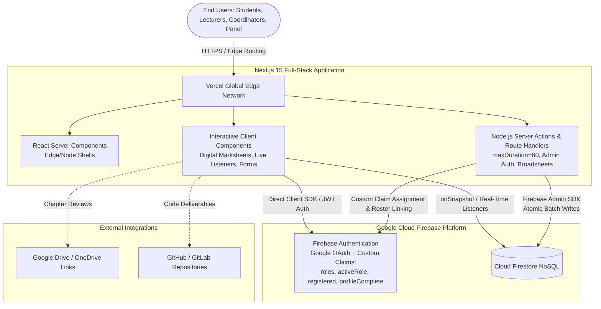
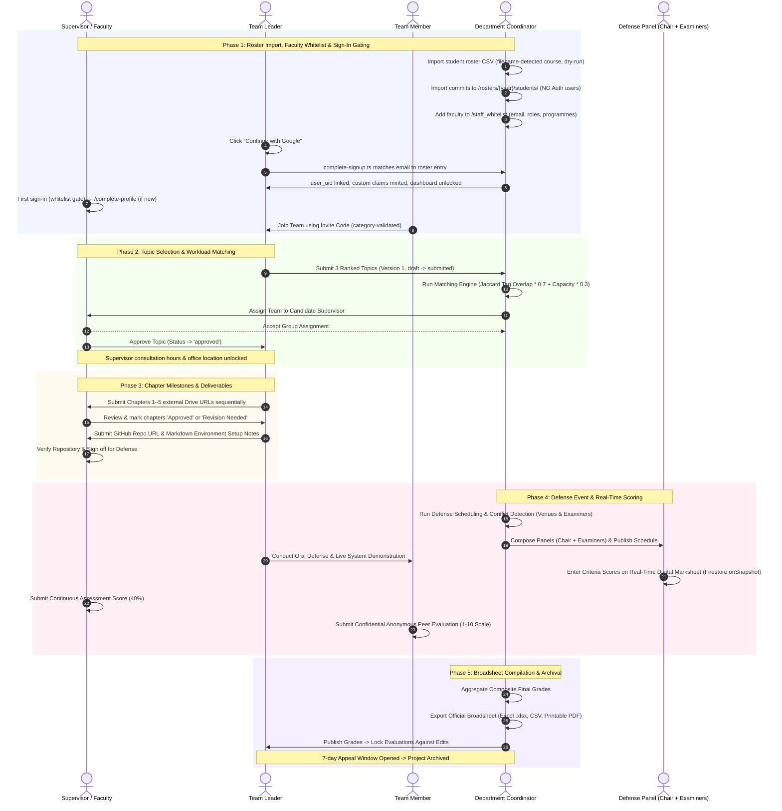

# **FINAL YEAR PROJECT MANAGEMENT SYSTEM**

### **System Requirements & Technical Specification Manual — Version 5.1 (Google Sign-In + Roster Gating)**
**Ho Technical University — Department of Computer Science**  
*Technology Stack: Next.js 15 (App Router) · Vercel · Firebase Authentication · Cloud Firestore · Tailwind CSS · TypeScript 5*  
*October 2026*

---

# **1. System Overview**

The **Final Year Project Management System** is a cloud-native, real-time academic platform designed to orchestrate, standardize, and automate the end-to-end final year capstone project lifecycle for the Department of Computer Science at Ho Technical University (HTU).

The system consolidates disparate, manual workflows—student roster onboarding, group formation, proposal review state machines, supervisor workload matching, sequential chapter milestone reviews, digital defense marksheet grading, peer contribution assessments, and official board broadsheet exports—into a cohesive, secure, and reactive web platform.

### **Core Objectives**
- **Eliminate Administrative Overhead:** Replace paper marksheets, manual Excel record-keeping, and scattered email threads with centralized, auditable digital workflows.
- **Serverless & Edge Architecture:** Deliver instantaneous page transitions and reactive state synchronization globally using **Next.js 15 (App Router)** hosted on **Vercel's Global Edge Network** with dedicated Node.js Server Actions for heavy operations.
- **Google Identity + Cohort Gating:** Institutional authentication via Google Workspace (@htu.edu.gh). Students are admitted only if their 10-digit index number appears in the current cohort roster; faculty are admitted only if their email appears in the staff whitelist. Multi-role RBAC is enforced via JWT Custom Claims (roles[], activeRole, registered, profileComplete).
- **Reactive Cloud Data Store:** Provide sub-second response times and real-time live browser synchronization via **Cloud Firestore**, allowing live score streaming during oral defense sessions.
- **Roster-First Onboarding:** Coordinators import student rosters via CSV (filename-detected course track with explicit confirmation). Import writes to a dedicated /rosters collection — no Firebase Auth users are created at import time. Students self-provision their Auth account on first Google sign-in, subject to a roster gate. Faculty are provisioned via a coordinator-maintained staff whitelist.
- **Gated Consultation Privacy:** Restrict access to supervisor personal consultation hours, office locations, and contact details until projects are formally approved and accepted.
- **Mathematical Workload Balancing:** Calculate supervisor allocation match scores based on normalized Jaccard topic keyword overlap, faculty research interests, and bounded active group capacities.
- **Departmental Broadsheet Exports & Grade Integrity:** Output departmental reports and grade broadsheets in **Excel (`.xlsx`)**, **CSV**, and official printable **PDF** formats with immutable post-publication locking and audit-logged amendment workflows.

---

# **2. User Personas & Roles**

The platform employs a dynamic Role-Based Access Control (RBAC) model allowing academic staff to hold multiple active roles (e.g., a lecturer acting as both a Project Supervisor and a Departmental Coordinator), switching active contexts seamlessly via the navigation bar.

```
                  [Institutional Identity (@htu.edu.gh)]
                                     │
         ┌───────────────────────────┼───────────────────────────┐
         │                           │                           │
    🎓 Student                 👨‍🏫 Supervisor               📋 Coordinator
(Teams, Proposals, Drive   (Roster Import, Topic Review,    (Workload Allocations,
Reviews, Deliverables,     Chapter Feedback, Continuous      Rubric Setup, Defense
Peer Evals, Grade Views)   Assessment, Repo Sign-off)       Panels, Broadsheets)
         │                           │                           │
         └───────────────────────────┼───────────────────────────┘
                                     │
                      ⚖️ Defense Panel Member / 🛡️ Admin
                    (Oral Defense Marksheets / System Auditing)
```

### **2.1 Student (Final Year)**
*Role: Undergraduate student enrolled in a final year capstone project course.*

**Primary Goals**
- Complete one-click Google Sign-In (identity validated against the cohort roster).
- Form or join a project team (4–5 members) using an auto-generated group number (e.g. `BICT26_01`) and a 6-character unique invite code.
- Select and submit 3 ranked project topics detailing title, abstract, problem statement, proposed solution, and tech stack tags.
- Track proposal approval transitions through an explicit state machine and submit versioned revisions if requested.
- View assigned supervisor and, once accepted, access their consultation contact details, office location, and consultation hours.
- Submit chapter review links (Google Drive / OneDrive) for sequential milestone evaluation (Chapters 1 to 5).
- Complete 360° anonymous peer evaluations for teammates across punctuality, technical output, and teamwork.
- Submit final software deliverables (GitHub repo URL, Live Demo link, and Markdown Environment Setup Notes).
- View individual and team grades post-defense and lodge appeals during the open appeal window.

### **2.2 Supervisor (Faculty Lecturer)**
*Role: Academic staff assigned to guide, mentor, and assess student groups.*

**Primary Goals**
- Maintain a staff whitelist entry (added by a coordinator) before first sign-in.
- Import student rosters via CSV to `/rosters` (filename-detected course with confirmation; no Auth users created at import time).
- Review submitted group topics; approve one topic or request structured revisions with persistent feedback notes.
- Accept or decline group assignments suggested by the coordinator's matching algorithm.
- Review sequential chapter submissions with line-item status (`Approved` or `Revision Needed`) and detailed line feedback.
- Track student team progress against academic calendar milestones.
- Submit continuous assessment evaluations (40% weight) against department rubric criteria.
- Inspect student GitHub code repositories, verify environment setup notes, and sign off on technical deliverables prior to defense.
- Review teammate peer evaluation summaries to detect free-riding and adjust continuous assessment scores.

### **2.3 Defense Panel Member / Examiner (Chair & Member)**
*Role: Faculty member appointed to evaluate oral defense presentations and software demonstrations.*

**Primary Goals**
- **Panel Chair:** Preside over defense sessions, verify panel quorum, initiate session timing, and formally submit composite panel consensus.
- **Panel Examiner:** Review assigned teams' final software deliverables, GitHub repository code, and chapter links prior to defense.
- Access dynamic, real-time digital defense marksheets on any device (tablets, laptops, phones) during oral presentations.
- Grade students individually and as a team against active panel rubric criteria; scores stream live to the panel chair and coordinator dashboard.

### **2.4 Final Year Project Coordinator**
*Role: Faculty head overseeing the departmental capstone program.*

**Primary Goals**
- Configure active academic sessions (`2025/2026`), semesters, and course tracks (`BTECH-CS`, `BTECH-ICT`, `HND-CS`, `HND-ICT`).
- Manage the staff whitelist — adding, updating, and deactivating faculty access.
- Manage unassigned student pool with auto-grouping tools and manual overrides.
- Compute supervisor match scores using the mathematically bounded Jaccard tag similarity and capacity formula, scoped to supervisors whose `programmes[]` include the team's `course_id`.
- Build and activate department defense rubrics with custom criteria, maximum points, and percentage weights (e.g. Supervisor: 40%, Defense Panel: 60%).
- Schedule defense events, allocate physical/virtual venues, compose examination panels (Chair + Examiners), and run automatic conflict detection across faculty schedules.
- Generate and export official department grade broadsheets in CSV, Excel (`.xlsx`), and official PDF formats with signature lines.
- Publish final grades, lock evaluation documents against further modification, and process formal grade amendment requests.

### **2.5 System Administrator**
*Role: IT personnel managing platform security, user permissions, and audit logs.*

**Primary Goals**
- Manage user accounts, role assignments, and permission matrices via Firebase Custom Claims.
- Execute global administrative overrides (e.g. forced group disbanding, emergency deadline extensions, member transfers).
- Monitor immutable system audit trails with action badges, actor metadata, and payload JSON deltas.
- Manage point-in-time recovery (PITR) and scheduled cloud data backups.

---

# **3. Technology Stack & Architectural Specifications**

| **Layer** | **Technology Selected** | **Architectural Purpose** |
| :--- | :--- | :--- |
| **Framework** | **Next.js 15 (App Router)** | Full-stack architecture utilizing React Server Components (RSC) for fast pre-rendered page shells and Server Actions for secure backend operations. |
| **Hosting & CDN** | **Vercel** | Serverless edge execution, global CDN asset delivery, automated branch previews, and zero-configuration HTTPS. |
| **Identity & Auth** | **Firebase Authentication** | Managed cloud identity via Google Workspace OAuth restricted to @htu.edu.gh. JWT Custom Claims encode roles[], activeRole, registered, and profileComplete for edge-safe RBAC. |
| **Database** | **Google Cloud Firestore** | Serverless NoSQL document database providing real-time document listeners (`onSnapshot`), atomic batch writes, and multi-region durability. |
| **Data Security** | **Firestore Security Rules** | Declarative security policies enforced at the database layer (`firestore.rules`) with strict ownership checks matching JWT custom claims. |
| **Styling & Theme** | **Tailwind CSS + `shadcn/ui`** | Modern design system with accessible components, responsive layouts, and native dark mode support. |
| **Icons** | **Lucide React** | Consistent, optimized SVG icon system. |
| **Form Validation** | **React Hook Form + Zod** | End-to-end type-safe form validation for CSV imports, topic submissions, and defense grading. |
| **Reporting Engines** | **`exceljs` + `@react-pdf/renderer`** | Pure TypeScript export pipeline generating departmental grade broadsheets, Excel spreadsheets with formulas, and official printable PDF broadsheets with signature lines. |
| **Language** | **TypeScript 5 (Strict)** | Strict compile-time type validation across database models, server actions, and UI state. |

### **3.1 Runtime Split & Execution Boundaries**
To prevent runtime errors and cold-start timeouts:
1. **Edge Runtime:** Used exclusively for lightweight middleware route guards (`middleware.ts`) and static RSC dashboard shells.
2. **Node.js Runtime (`export const runtime = 'nodejs'`):** Used for all Server Actions and Route Handlers utilizing `firebase-admin`, `exceljs`, and `@react-pdf/renderer`.
3. **Execution Timeout Configuration:** Heavy operations like bulk CSV roster imports and broadsheet generation explicitly set `export const maxDuration = 60;` to exceed the standard 10-second serverless timeout.
4. **Client SDK vs. Admin SDK Split:**
   - **Client SDK (`lib/firebase/client.ts`):** Handles user session persistence, Google Sign-In, and real-time reactive UI subscriptions (`onSnapshot`).
   - **Admin SDK (`lib/firebase/admin.ts`):** Initialized as a singleton on `globalThis` to prevent connection leaks, executing privileged operations (custom claim assignment, batch commits) with service account credentials.
5. **Token Forwarding:** Client components invoking Server Actions forward the active Firebase ID token (`await user.getIdToken()`), which the Server Action validates using `adminAuth.verifyIdToken(token)` before performing privileged database mutations.

---

# **4. System Architecture — Serverless Topology**



---

# **5. Functional Requirements**

## **FR-01: Google Authentication, Roster Gating & Role-Based Access Control**

| **ID** | **Requirement** | **Priority** |
| :--- | :--- | :--- |
| **FR-01.1** | Users authenticate exclusively via Google Sign-In (Firebase Auth GoogleAuthProvider). Only email addresses ending in `@htu.edu.gh` are accepted. All other domains are rejected before any Firestore lookup. | High |
| **FR-01.2** | System enforces multi-role RBAC via Firebase Auth Custom Claims. Claims schema: `{ roles: string[], activeRole: string, registered: boolean, profileComplete: boolean }`. Allowed roles: `student`, `supervisor`, `coordinator`, `admin`, `panel_member`. | High |
| **FR-01.3** | **Active Role Switching:** Faculty with multiple roles switch active contexts via a navbar dropdown. The action invokes `switch-role.ts` Server Action, which calls `adminAuth.setCustomUserClaims(uid, { ...claims, activeRole })`, returns a fresh ID token, and the client calls `getIdToken(true)` before navigation. The client MUST await the new token before rendering role-scoped UI. | High |
| **FR-01.4** | **Student Roster CSV Import:** Supervisors and Coordinators can bulk-import student rosters via CSV. Import writes to `rosters/{academicYearId}/students/{indexNumber}`. The import interface includes filename-based course detection (with explicit UI confirmation), batch-size controls (25, 50, 100), template download, dry-run mode, and summary metrics (`Total`, `Imported`, `Skipped`, `Errors`). NO Firebase Auth users are created at import time — see §5.1 and §5.2. | High |
| **FR-01.5** | **Student Index Format Validation:** Index numbers MUST match the strict regex `^[0-9]{10}$`. Emails are derived deterministically as `${indexNumber}@htu.edu.gh`. Records failing this regex are rejected at import with a per-row error message. | High |
| **FR-01.6** | **First Sign-In Roster Linkage (`complete-signup.ts`):** On first Google Sign-In, the authenticated email is matched against the current cohort roster. If the email matches `^[0-9]{10}@htu\.edu\.gh$`, the index number is extracted and the doc `rosters/{currentYear}/students/{indexNumber}` is read. If found and `user_uid` is null, the Server Action sets `user_uid = request.auth.uid` (write-once), creates `users/{uid}`, and mints claims `{ roles: ['student'], activeRole: 'student', registered: true, profileComplete: true }`. If not found, the user is redirected to `/not-registered` with a coordinator contact message. | High |
| **FR-01.7** | **Faculty Whitelist Gating:** Supervisors, coordinators, panel members, and admins MUST be added to `staff_whitelist/{email}` by a coordinator or admin before they can access the system. On first Google Sign-In, if the email does not match the student pattern, the Server Action reads `staff_whitelist/{email}`. If found and `is_active` is true, the Server Action creates `users/{uid}` with `profile_complete: false` and mints claims `{ roles: staffDoc.roles, activeRole: staffDoc.roles[0], registered: true, profileComplete: false }`. If not found, the user is redirected to `/not-registered` with a coordinator/HoD contact message. | High |
| **FR-01.8** | **Unregistered Access Handling:** Users whose Google account is not in the roster or staff whitelist see an unclosable `/not-registered` page with: (a) the attempted email, (b) a category-specific error message, (c) a contact email for the coordinator, and (d) a sign-out button. All routes redirect to `/not-registered` while `token.registered == false`. Unregistered users are NOT deleted from Firebase Auth — they remain for audit purposes but cannot reach any authenticated route. | High |
| **FR-01.9** | **Profile Completion Gate (Faculty):** Newly registered faculty have `profileComplete: false`. Middleware redirects them to `/complete-profile` until they set `office_location`, `consultation_hours`, `research_interests[]`, and `max_team_capacity`. Students skip this gate (auto-profileComplete: true). | High |
| **FR-01.10** | **Category Integrity (Cross-Cutting):** A student's `course_id` is authoritatively set from their roster entry at first sign-in. It is immutable thereafter except via a dedicated admin action. Category integrity is enforced at five points: (1) team join validates joining student's `course_id` matches `team.course_id`; (2) `group_number` prefix is derived from `course_id`; (3) supervisor matching filters candidates to those whose staff `programmes[]` includes the team's `course_id`; (4) broadsheet export groups strictly by `course_id`; (5) defense panel assignment filters examiners by programme match, with coordinator override logged to `audit_logs`. | High |
| **FR-01.11** | **Staff Whitelist Management:** Coordinators and admins can add, edit, and deactivate staff whitelist entries via a UI form. Each entry records `{ email, full_name, roles[], department, programmes[], is_active, added_by_uid, added_at }`. Deactivation sets `is_active: false` and revokes the user's custom claims on their next token refresh (documented as a 1-hour delayed effect in §9). | High |

### **5.1 Student Roster Import (Roster-First, No Auth Writes)**

The CSV import writes ONLY to `/rosters` — it never creates Firebase Auth users. This eliminates the need for complex compensating rollback workflows because no Auth user exists yet at import time.

Pipeline:
1. **Filename Course Detection:** The uploaded file's basename is matched against known patterns (case-insensitive, allowing `_`, `-`, or space as separators): `btech_cs` $\rightarrow$ `btech-cs`, `btech_ict` $\rightarrow$ `btech-ict`, `hnd_cs` $\rightarrow$ `hnd-cs`, `hnd_ict` $\rightarrow$ `hnd-ict`. If ambiguous or unmatched, the user is prompted to select the course manually. The detected course is shown in a confirmation step ("We detected this is a BTECH-ICT roster. Confirm or change.") — detection is a hint, not authoritative.
2. **Pre-Validation:** Server-side Zod re-validation of every row (10-digit index regex `^[0-9]{10}$`, non-empty name). Duplicate index numbers within the file are flagged. Index numbers already present in `rosters/{currentYear}/students/` are flagged as Skipped (Duplicate).
3. **Dry-Run Mode:** NFR-08 dry-run returns the full validation report without any Firestore writes. The coordinator reviews the report before committing.
4. **Batch Write:** Valid rows are committed in batches of 50 via `db.batch()`, each writing one roster doc. No Auth calls. No compensating logic needed — a failed batch rolls back cleanly at the Firestore level.
5. **Audit:** A single `/audit_logs` entry is written per import: `{ action: 'roster.imported', course_id, filename, total, imported, skipped, errors, imported_by_uid, academic_year_id }`.

### **5.2 Sign-In Linkage Flow (`complete-signup.ts`)**

Triggered by the client after successful Google Sign-In, with the fresh ID token forwarded in the Server Action body.

1. `verifyIdToken` $\rightarrow$ `{ uid, email }`.
2. **Domain Gate:** If email does not end with `@htu.edu.gh`, return 403 with "Use your HTU account." Sign out client-side.
3. **Branch on Email Pattern:**
   - a) `email` matches `^[0-9]{10}@htu\.edu\.gh$` $\rightarrow$ **STUDENT PATH** (step 4)
   - b) else $\rightarrow$ **FACULTY PATH** (step 5)
4. **Student Path:**
   - a) Extract `indexNumber = email.localPart`.
   - b) Read `rosters/{currentYear}/students/{indexNumber}`.
   - c) If missing $\rightarrow$ 403 "Not in current final-year cohort. Contact your coordinator." Client redirects to `/not-registered`.
   - d) If present and `user_uid === null` $\rightarrow$ begin Firestore transaction: update roster doc with `{ user_uid: uid, signup_completed_at: serverTimestamp() }`; set `users/{uid}` `{ name, email, role: 'student', roles: ['student'], active_role: 'student', profile: { index_number, course_id, registered: true, profile_complete: true }, created_at, updated_at }`. Commit. Set custom claims `{ roles: ['student'], activeRole: 'student', registered: true, profileComplete: true }`. Return `{ ok: true, activeRole: 'student' }`.
   - e) If present and `user_uid === uid` $\rightarrow$ idempotent success. Return `{ ok: true }`.
   - f) If present and `user_uid` is a DIFFERENT `uid` $\rightarrow$ append `/audit_logs` `{ action: 'identity_conflict', index_number, email, attempted_uid, existing_uid }`. Return 409 "This index is already linked to another account. Contact the coordinator."
5. **Faculty Path:**
   - a) Read `staff_whitelist/{email}`.
   - b) If missing or `is_active === false` $\rightarrow$ 403 "Not a registered supervisor for this semester. Contact your coordinator/HoD." Client redirects to `/not-registered`.
   - c) If present and `is_active === true` $\rightarrow$ Firestore transaction: create or update `users/{uid}` with staff profile fields (`name`, `staff_id`, `department`, `phone`, `programmes`) and set `profile_complete: false` (unless already true from prior sign-in). Set custom claims `{ roles: staffDoc.roles, activeRole: staffDoc.roles[0], registered: true, profileComplete: <current> }`. Update `staff_whitelist` doc `{ user_uid: uid }` if not already set (write-once). Return `{ ok: true, activeRole, profileComplete }`.
6. Client calls `getIdToken(true)` to receive fresh claims, then `onAuthStateChanged` routes to `/complete-profile` (faculty, `profileComplete: false`) or dashboard.

---

## **FR-02: Group Management & Unassigned Student Pool**

| **ID** | **Requirement** | **Priority** |
| :--- | :--- | :--- |
| **FR-02.1** | Students can create a project team (4–5 members) with the creator designated as Team Leader. | High |
| **FR-02.2** | System auto-generates unique group numbers formatted as `{CourseCode}{YY}_{Sequence:02d}` (e.g. `BICT26_01`, `BCS26_02`). | High |
| **FR-02.3** | Students join groups using a 6-character unique alphanumeric invite code (e.g. `K9X2P4`) generated upon team creation. | High |
| **FR-02.4** | Team Leaders can invite teammates via index number or email; team joining validates membership caps (max 5). | High |
| **FR-02.4a** | **Team Course-Category Integrity:** A student may only create or join teams whose `course_id` matches their own `profile.course_id` (set from their roster entry at first sign-in). Create and join Server Actions MUST validate this inside a Firestore transaction. A mismatch returns 409 "This team belongs to a different programme. You can only join teams in your own course track." | High |
| **FR-02.5** | Students cannot belong to multiple active project groups concurrently in the same academic year. | High |
| **FR-02.5a** | **Group Number Prefix Integrity:** The `group_number` prefix is derived from `team.course_id` (`btech-cs` $\rightarrow$ `BCS`, `btech-ict` $\rightarrow$ `BICT`, `hnd-cs` $\rightarrow$ `HCS`, `hnd-ict` $\rightarrow$ `HICT`). The prefix is never user-supplied and is validated server-side. | High |
| **FR-02.6** | **Coordinator Pool & Auto-Grouping Tool:** Coordinator can view all unassigned students after the formation deadline, run an auto-grouping algorithm (clustering strictly by `course_id`; cross-category merging is disallowed even under auto-grouping, except via explicit admin override per FR-02.7 which logs to `audit_logs`), or manually assign students to existing/new teams. | High |
| **FR-02.7** | **Admin Overrides:** System Admin can override min/max group size limits, execute member transfers, or disband groups at any lifecycle stage with automatic notification. | High |

---

## **FR-03: Topic Selection, State Machine & Versioning**

| **ID** | **Requirement** | **Priority** |
| :--- | :--- | :--- |
| **FR-03.1** | Each group submits 3 ranked project topics (`preference_rank: 1 | 2 | 3`) detailing title, abstract, problem statement, proposed solution, and tech stack tags. | High |
| **FR-03.2** | Topic approval lifecycle follows an explicit state machine: `draft` $\rightarrow$ `submitted` $\rightarrow$ `under_review` $\rightarrow$ `approved` / `rejected` / `revision_requested`. | High |
| **FR-03.3** | **Duplicate Detection:** Automated keyword overlap check alerts teams and supervisors if a submitted topic has high textual similarity with archived past projects. | Medium |
| **FR-03.4** | Supervisors review submitted proposals, leave review notes, and approve exactly one primary topic for execution. | High |
| **FR-03.5** | **Topic Versioning & Resubmission:** Teams whose topics require revision or are rejected can submit updated proposals without corrupting rank uniqueness. Each update increments `version: number`, archives the prior proposal snapshot in subcollection `/topics/{topicId}/history`, and marks the new revision as `is_current: true`. | High |

---

## **FR-04: Supervisor Matching & Contact Information Gating**

| **ID** | **Requirement** | **Priority** |
| :--- | :--- | :--- |
| **FR-04.1** | System calculates a **Supervisor Match Score** combining normalized Jaccard topic keyword overlap, lecturer specialization tags, and bounded capacity quotas. | High |
| **FR-04.2** | Coordinator views ranked supervisor recommendations (top 3) when assigning groups, with manual override support. | High |
| **FR-04.2a** | **Programme-Scoped Candidate Filter:** The matching engine only considers supervisors whose `staff_whitelist.programmes[]` includes the team's `course_id`. A supervisor who does not list the team's programme is not shown as a candidate. Coordinators may manually override with an audit-logged reason. | High |
| **FR-04.3** | Supervisor accepts or declines group assignment within a designated notification window. | High |
| **FR-04.4** | **Gated Contact Details:** Supervisor consultation hours, office location, and direct contact numbers are strictly hidden from students until the supervisor accepts assignment and the topic is approved. | High |

### **4.1 Mathematical Specification for Supervisor Match Score**
Candidate supervisors are first filtered to those whose `programmes[]` contains the team's `course_id`; the Jaccard/capacity formula is then applied only to the filtered candidate set.

Let:
- $T$ = Set of lowercase keyword tags associated with the student team's approved topic.
- $S$ = Set of lowercase research specialization tags configured on the supervisor profile.
- $C_{\text{curr}}$ = Current count of active groups assigned to the supervisor.
- $C_{\text{max}}$ = Configured maximum team capacity for the supervisor ($C_{\text{max}} \ge 1$; defaults to 5 if unset).

1. **Tag Overlap Metric (Jaccard Similarity):**
   $$\text{TagOverlap}(T, S) = \begin{cases} \frac{|T \cap S|}{|T \cup S|}, & \text{if } |T \cup S| > 0 \\ 0, & \text{if } |T \cup S| = 0 \end{cases}$$

2. **Workload Capacity Metric:**
   $$\text{CapacityScore}(C_{\text{curr}}, C_{\text{max}}) = \max\left(0.0, \, 1.0 - \frac{C_{\text{curr}}}{\max(1, C_{\text{max}})}\right)$$
   *(Note: Bounded strictly in $[0.0, 1.0]$. If $C_{\text{curr}} \ge C_{\text{max}}$, the capacity term cleanly evaluates to $0.0$, preventing negative scores).*

3. **Composite Match Score:**
   $$\text{MatchScore} = (\text{TagOverlap} \times 0.7) + (\text{CapacityScore} \times 0.3)$$
   *(Result is strictly bounded between $0.0$ and $1.0$).*

---

## **FR-05: Chapter Submission via External Document Links**

| **ID** | **Requirement** | **Priority** |
| :--- | :--- | :--- |
| **FR-05.1** | Students submit 5 sequential chapters by providing shared Google Drive or OneDrive URLs (avoiding heavy server storage). | High |
| **FR-05.2** | Submission history preserves prior version links, revision dates, and supervisor line-item comments using the `chapters` collection. | High |
| **FR-05.3** | Supervisors review external document links and record milestone status as `Approved` or `Revision Needed`. | High |
| **FR-05.4** | Automated notifications alert supervisors of unreviewed chapter submissions approaching calendar milestones. | Medium |

---

## **FR-06: Multi-Evaluator Defense Scoring & Peer Contribution Assessment**

| **ID** | **Requirement** | **Priority** |
| :--- | :--- | :--- |
| **FR-06.1** | **Customizable Rubrics:** Coordinator configures department rubric criteria and sets weighting percentages (e.g. Supervisor Continuous Assessment: 40%, Defense Panel: 60%). | High |
| **FR-06.2** | **Real-Time Digital Marksheet:** Panel members and supervisors access real-time scoring sheets during defense presentations; scores stream live via Firestore `onSnapshot`. Optimistic UI state provides immediate feedback (<100ms) with Firestore reconciliation (~150–500ms on campus Wi-Fi). | High |
| **FR-06.3** | **Live Score Aggregation:** Individual examiner scores are written to separate evaluation documents. The panel chair and coordinator dashboards compute a live composite score in real time. Upon session conclusion, an idempotent Server Action writes the verified aggregate score to the team summary. | High |
| **FR-06.4** | **360° Anonymous Peer Assessment:** Group members submit confidential ratings for teammates across punctuality, technical output, and teamwork (scale 1–10). | High |
| **FR-06.5** | **Peer Score Confidentiality & Free-Rider Detection:** Teammates can never view individual peer ratings submitted by their peers. Only supervisors and coordinators can inspect aggregated peer evaluations to identify free-riders and adjust continuous assessment marks. | High |

---

## **FR-07: Defense Scheduling, Panel Management & Conflict Detection**

| **ID** | **Requirement** | **Priority** |
| :--- | :--- | :--- |
| **FR-07.1** | Coordinator creates defense events, schedules presentation time slots, and assigns physical or virtual meeting venues. | High |
| **FR-07.2** | Coordinator forms Defense Panels with explicit roles: **Panel Chair** (session lead) and **Examiners** (panel members). | High |
| **FR-07.2a** | **Programme-Scoped Panel Assignment:** When composing defense panels, the system defaults to examiners whose `staff_whitelist.programmes[]` includes the panel's `course_id`. Coordinators may assign cross-programme examiners with an audit-logged justification. | High |
| **FR-07.3** | **Automated Conflict Detection:** System automatically detects and flags scheduling conflicts before finalizing panel allocations: (1) Examiner double-booked in overlapping time slots across different panels, and (2) Physical venue double-booked for identical time slots. | High |
| **FR-07.4** | Panel members receive automated schedule notifications with direct links to candidate team deliverables. | High |

---

## **FR-08: Software Deliverables & Environment Setup Notes**

| **ID** | **Requirement** | **Priority** |
| :--- | :--- | :--- |
| **FR-08.1** | Following defense, groups submit final software deliverables: GitHub/GitLab repository URL, Live Demo URL, and cloud storage manuscript link. | High |
| **FR-08.2** | Groups submit **Environment Setup Notes** (Markdown field covering runtime dependencies, environment variables, test credentials, and seed instructions) for supervisor verification. | High |
| **FR-08.3** | Supervisors test repository environments and record formal sign-off before grades are published. | High |

---

## **FR-09: Communication & Real-Time Notifications**

| **ID** | **Requirement** | **Priority** |
| :--- | :--- | :--- |
| **FR-09.1** | In-app notification center for all activity events (topic approval, feedback, defense schedule updates) backed by the `/notifications` collection. | High |
| **FR-09.2** | Real-time toast alerts notify active users instantly of incoming milestone reviews and approvals. | High |
| **FR-09.3** | Automated transactional emails sent for critical milestones (assignment acceptance, defense call-up). | Medium |

---

## **FR-10: Department Broadsheets, Grade Locking & Immutability**

| **ID** | **Requirement** | **Priority** |
| :--- | :--- | :--- |
| **FR-10.1** | **Multi-Format Broadsheet Exports:** Coordinator can export official Department Broadsheets in **Excel (`.xlsx`)** with HTU styling and formulas, registrar-compatible flat **CSV**, and official printable **PDF** broadsheets with signature lines for the Head of Department and Dean. | High |
| **FR-10.1a** | **Category-Segregated Broadsheet Export:** Department broadsheets are grouped by `course_id` (BTECH-CS / BTECH-ICT / HND-CS / HND-ICT), with separate signature blocks per programme. Cross-programme contamination is impossible because `course_id` is authoritative on `users/{uid}.profile` and rosters. | High |
| **FR-10.2** | **Grade Immutability:** Once the Coordinator marks grades as published, Firestore security rules permanently lock all `/evaluations` records for that academic session against writes, updates, or deletions. | High |
| **FR-10.3** | **Grade Amendment Workflow:** Any post-publication grade amendment requires a formal written petition submitted to the Coordinator, who must execute the change via a dedicated administrative Server Action that logs the old score, new score, justification, and timestamp to `/audit_logs`. | High |
| **FR-10.4** | **Student Grade Appeal Window:** Students have a 7-calendar-day window following publication to lodge a digital grade appeal inquiry through their dashboard. | Medium |

---

## **FR-11: Project Archive & Searchable Repository**

| **ID** | **Requirement** | **Priority** |
| :--- | :--- | :--- |
| **FR-11.1** | Approved and completed projects automatically transition into a permanent, searchable **Project Archive**. | Medium |
| **FR-11.2** | Archive records store project title, abstract, keywords, academic year, course track, GitHub repository link, and final manuscript drive URL. | Medium |
| **FR-11.3** | Junior students can search past project abstracts and keywords to research prior work and prevent topic duplication. | Medium |

---

# **6. Non-Functional Requirements**

| **ID** | **Category** | **Requirement Specification** |
| :--- | :--- | :--- |
| **NFR-01** | **Performance & Latency** | Pre-rendered RSC shells load under 400ms globally via Vercel CDN. Digital marksheets implement optimistic UI updates (<100ms) with background Firestore synchronization under 500ms on standard campus Wi-Fi. |
| **NFR-02** | **Security & Token Integrity** | Firestore Security Rules enforce ownership and JWT Custom Claim validation (roles[], activeRole, registered, profileComplete). Sign-in identity is established via Google OAuth and validated against /rosters (students) or /staff_whitelist (faculty) inside a Firestore transaction in complete-signup.ts. Unregistered accounts are denied all authenticated routes. Server Actions execute adminAuth.verifyIdToken(token) before any privileged mutation. Identity-linkage conflicts are logged to /audit_logs. |
| **NFR-03** | **Scalability** | Cloud Firestore architecture scales seamlessly to accommodate concurrent evaluation scoring across 1,000+ active students and defense examiners during peak defense periods. |
| **NFR-04** | **Data Integrity & Batch Operations** | Batch transactions (50 records per commit) used in student roster onboarding and grade aggregation to ensure atomic commits and prevent partial document writes. |
| **NFR-05** | **Auditability** | Every grade submission, topic state transition, roster import, role switch, and identity conflict is permanently recorded in an immutable, append-only `/audit_logs` collection. |
| **NFR-06** | **Responsive UX** | Accessible UI built with Tailwind CSS and `shadcn/ui`, enabling defense panel examiners to comfortably grade on mobile phones, iPads/tablets, or laptops. |
| **NFR-07** | **Disaster Recovery & Backups** | Cloud Firestore configured with daily automated exports to Google Cloud Storage (GCS) and Point-in-Time Recovery (PITR) enabled for 7-day granular rollbacks. |
| **NFR-08** | **Environment Isolation** | Separate staging and production Firebase environments with a dedicated CSV roster dry-run validation mode before live database insertion. |
| **NFR-09** | **Claim Propagation Delay** | Custom claims propagate within 1 hour (Firebase ID token lifetime). Removal of a user from the roster or deactivation of a staff whitelist entry takes effect within 1 hour or on the user's next token refresh. Coordinators requiring immediate revocation must use the admin 'Force Revoke Session' action, which calls adminAuth.revokeRefreshTokens(uid) and forces the user to re-authenticate and re-pass the roster/whitelist gate. |

---

# **7. Key Workflows**



---

# **8. Cloud Firestore Data Schema**

The database schema is structured into 16 collections and subcollections optimized for fast indexing, real-time listeners, and atomic batch updates:

```
firestore-root/
├── users/                         # User accounts & academic profiles
├── rosters/                       # Per-year student rosters (import target)
│   └── {yearId}/students/         # One doc per student, keyed by index number
├── staff_whitelist/               # Pre-approved faculty (keyed by @htu.edu.gh email)
├── courses/                       # Degree & Diploma programs (BTECH-CS, etc.)
├── academic_years/                # Academic calendar sessions & milestone dates
├── teams/                         # Capstone project groups
│   └── members/                   # Subcollection of team members
├── topics/                        # Project topic proposals & review states
│   └── history/                   # Subcollection of past topic revisions
├── supervisions/                  # Supervisor allocations & capacity records
├── chapters/                      # Chapter 1–5 external review links & feedback
├── rubrics/                       # Department grading rubrics & criteria
├── defense_panels/                # Defense examination panels, venues & time slots
├── evaluations/                   # Supervisor & panel member scores
├── peer_evaluations/              # Teammate 360° confidential peer assessments
├── software_deliverables/         # GitHub repositories & environment setup notes
├── notifications/                 # In-app notification messages
└── audit_logs/                    # Immutable system audit trail
```

---

### **8.1 Document Interfaces & Specifications**

#### **Collection: `users/{uid}`**
```typescript
interface UserDocument {
  uid: string;
  name: string;
  email: string;
  role: 'student' | 'supervisor' | 'coordinator' | 'admin' | 'panel_member'; // Primary display role
  roles: string[];                  // All authorized roles: e.g. ['supervisor', 'coordinator', 'panel_member']
  active_role: string;              // Current active context: e.g. 'coordinator'
  profile: {
    index_number?: string;          // e.g. "0323809921" (Students)
    staff_id?: string;              // e.g. "SUP-001" (Faculty)
    course_id?: string;             // References /courses/{courseId}
    programmes?: string[];          // Superviseable tracks for faculty (e.g. ["btech-ict", "hnd-ict"])
    registered: boolean;
    profile_complete: boolean;      // false for new faculty, true for students
    phone?: string;
    office_location?: string;       // Gated for approved teams
    consultation_hours?: string;    // Gated for approved teams
    research_interests?: string[];  // e.g. ["ai/ml", "cybersecurity", "cloud"]
    max_team_capacity?: number;     // e.g. 5 teams
    current_team_count?: number;    // Active assigned teams count
  };
  created_at: FirebaseFirestore.Timestamp;
  updated_at: FirebaseFirestore.Timestamp;
}
```

#### **Collection: `rosters/{yearId}/students/{indexNumber}`**
```typescript
interface RosterStudentDocument {
  index_number: string;             // 10 digits: e.g. "0323080281"
  full_name: string;
  email: string;                    // derived: `${index_number}@htu.edu.gh`
  course_id: string;                // "btech-ict" | "btech-cs" | "hnd-ict" | "hnd-cs"
  imported_by_uid: string;
  imported_at: FirebaseFirestore.Timestamp;
  import_batch_id: string;          // groups rows from a single CSV upload
  user_uid: string | null;          // write-once, set on first successful signup
  signup_completed_at: FirebaseFirestore.Timestamp | null;
}
```

#### **Collection: `staff_whitelist/{email}`**
```typescript
interface StaffWhitelistDocument {
  email: string;                    // doc ID, e.g. "kklu@htu.edu.gh"
  full_name: string;
  roles: string[];                  // e.g. ["supervisor"] or ["supervisor", "coordinator"]
  department: string;               // e.g. "Computer Science"
  programmes: string[];             // e.g. ["btech-ict", "hnd-ict"] — superviseable tracks
  phone?: string;
  is_active: boolean;
  added_by_uid: string;
  added_at: FirebaseFirestore.Timestamp;
  user_uid: string | null;          // linked after first sign-in
  last_signin_at?: FirebaseFirestore.Timestamp;
}
```

#### **Collection: `courses/{courseId}`**
```typescript
interface CourseDocument {
  id: string;                       // e.g. "btech-cs"
  code: string;                     // e.g. "BTECH-CS", "BTECH-ICT", "HND-CS", "HND-ICT"
  name: string;                     // e.g. "BTech Computer Science"
  department: string;               // e.g. "Computer Science"
}
```

#### **Collection: `academic_years/{yearId}`**
```typescript
interface AcademicYearDocument {
  id: string;                       // e.g. "2025-2026"
  code: string;                     // e.g. "2025/2026"
  semester: 1 | 2;
  is_active: boolean;
  deadlines: {
    roster_import_deadline: FirebaseFirestore.Timestamp;
    team_formation_deadline: FirebaseFirestore.Timestamp;
    topic_submission_deadline: FirebaseFirestore.Timestamp;
    chapters_deadline: FirebaseFirestore.Timestamp;
    defense_start_date: FirebaseFirestore.Timestamp;
    defense_end_date: FirebaseFirestore.Timestamp;
    grade_appeal_deadline?: FirebaseFirestore.Timestamp;
  };
  grades_published: boolean;
  created_at: FirebaseFirestore.Timestamp;
}
```

#### **Collection: `teams/{teamId}`**
```typescript
interface TeamDocument {
  id: string;
  name: string;
  group_number: string;             // Formatted: "{CourseCode}{YY}_{Sequence}" -> "BICT26_01"
  invite_code: string;              // 6-character unique alphanumeric code (e.g. "K9X2P4")
  course_id: string;                // MUST match every member's profile.course_id
  academic_year_id: string;
  leader_id: string;                // References users/{uid}
  member_ids: string[];             // Array of student UIDs for indexing
  member_count: number;
  max_members: number;              // Standard: 5
  status: 'formation' | 'topic_pending' | 'topic_approved' | 'defense_ready' | 'completed' | 'disbanded';
  assigned_supervisor_id?: string;
  approved_topic_id?: string;
  scores_summary?: {
    supervisor_score: number;       // Weighted 40%
    panel_average_score: number;    // Weighted 60%
    composite_final_score: number;  // 0 - 100
    grade_classification: string;   // e.g. "First Class", "Pass"
    is_locked: boolean;
  };
  created_at: FirebaseFirestore.Timestamp;
  updated_at: FirebaseFirestore.Timestamp;
}
```

#### **Collection: `topics/{topicId}`**
```typescript
interface TopicDocument {
  id: string;
  team_id: string;
  title: string;
  abstract: string;
  problem_statement: string;
  proposed_solution: string;
  tech_stack: string[];             // e.g. ["next.js", "firebase", "typescript"]
  preference_rank: 1 | 2 | 3;
  version: number;                  // Incremented on resubmission
  is_current: boolean;              // True for the active proposal revision
  status: 'draft' | 'submitted' | 'under_review' | 'approved' | 'rejected' | 'revision_requested';
  reviewed_by_user_id?: string;
  review_notes?: string;
  submitted_at: FirebaseFirestore.Timestamp;
  reviewed_at?: FirebaseFirestore.Timestamp;
}
```

#### **Collection: `supervisions/{supervisionId}`**
```typescript
interface SupervisionDocument {
  id: string;
  supervisor_id: string;           // References users/{uid}
  academic_year_id: string;
  max_capacity: number;             // Default 5
  current_assigned_count: number;
  assigned_team_ids: string[];
  status: 'available' | 'at_capacity';
  updated_at: FirebaseFirestore.Timestamp;
}
```

#### **Collection: `chapters/{chapterId}`**
```typescript
interface ChapterFeedback {
  id: string;
  author_id: string;
  content: string;
  created_at: FirebaseFirestore.Timestamp;
}

interface ChapterDocument {
  id: string;
  team_id: string;
  chapter_number: 1 | 2 | 3 | 4 | 5;
  title: string;                    // e.g. "Chapter 1: Introduction"
  document_url: string;             // External Google Drive / OneDrive link
  version: number;
  status: 'pending' | 'approved' | 'revision_needed';
  feedback: ChapterFeedback[];
  submitted_at: FirebaseFirestore.Timestamp;
  reviewed_at?: FirebaseFirestore.Timestamp;
}
```

#### **Collection: `defense_panels/{panelId}`**
```typescript
interface DefenseTimeSlot {
  slot_id: string;
  team_id: string;
  start_time: FirebaseFirestore.Timestamp;
  end_time: FirebaseFirestore.Timestamp;
  status: 'scheduled' | 'in_progress' | 'completed' | 'cancelled';
}

interface DefensePanelDocument {
  id: string;
  academic_year_id: string;
  course_id: string;
  panel_name: string;               // e.g. "Panel A - Software Systems"
  venue: string;                    // e.g. "CS Lab 2" or "Virtual - Google Meet"
  is_virtual: boolean;
  virtual_meeting_url?: string;
  chair_id: string;                 // References users/{uid} (Panel Chair)
  examiner_ids: string[];           // Array of faculty UIDs
  time_slots: DefenseTimeSlot[];
  created_at: FirebaseFirestore.Timestamp;
}
```

#### **Collection: `rubrics/{rubricId}`**
```typescript
interface RubricCriterion {
  id: string;
  title: string;
  description: string;
  max_points: number;
  category: 'oral_defense' | 'system_demo' | 'technical_architecture';
}

interface RubricDocument {
  id: string;
  title: string;
  max_score: number;
  supervisor_weight_pct: number;    // e.g. 40
  panel_weight_pct: number;         // e.g. 60
  is_active: boolean;
  criteria: RubricCriterion[];
  created_at: FirebaseFirestore.Timestamp;
}
```

#### **Collection: `evaluations/{evaluationId}`**
```typescript
interface EvaluationDocument {
  id: string;
  team_id: string;
  student_id?: string;              // Optional for individual scoring; null for group scoring
  evaluator_id: string;             // References users/{uid}
  evaluator_role: 'supervisor' | 'panel_chair' | 'panel_member';
  rubric_id: string;
  scores: {
    [criterionId: string]: number;  // Line-item scores
  };
  total_score: number;
  comments: string;
  is_published: boolean;            // Locked when true
  created_at: FirebaseFirestore.Timestamp;
  updated_at: FirebaseFirestore.Timestamp;
}
```

#### **Collection: `peer_evaluations/{peerEvalId}`**
```typescript
interface PeerEvaluationDocument {
  id: string;
  team_id: string;
  evaluator_id: string;             // Student UID submitting rating (confidential)
  evaluatee_id: string;             // Teammate UID being rated
  punctuality_score: number;        // 1 to 10
  technical_contribution_score: number;
  teamwork_score: number;
  average_score: number;            // Computed average (1.0 to 10.0)
  comments: string;
  submitted_at: FirebaseFirestore.Timestamp;
}
```

#### **Collection: `software_deliverables/{teamId}`**
```typescript
interface SoftwareDeliverableDocument {
  team_id: string;
  github_repository_url: string;
  live_demo_url?: string;
  google_drive_url?: string;
  environment_setup_notes: string;  // Markdown setup instructions & credentials
  submitted_by_user_id: string;
  approved_by_supervisor_at?: FirebaseFirestore.Timestamp;
  supervisor_signoff_notes?: string;
  submitted_at: FirebaseFirestore.Timestamp;
}
```

#### **Collection: `notifications/{notificationId}`**
```typescript
interface NotificationDocument {
  id: string;
  user_id: string;                  // Recipient UID
  title: string;
  body: string;
  type: 'topic_status' | 'chapter_review' | 'defense_schedule' | 'grade_published';
  target_url?: string;
  is_read: boolean;
  created_at: FirebaseFirestore.Timestamp;
}
```

#### **Collection: `audit_logs/{logId}`**
```typescript
interface AuditLogDocument {
  id: string;
  actor_id: string;
  actor_name: string;
  actor_email: string;
  actor_role: string;
  action: 
    | 'roster.imported'
    | 'staff.whitelist_added'
    | 'staff.whitelist_deactivated'
    | 'student.signup_completed'
    | 'faculty.signup_completed'
    | 'identity_conflict'
    | 'profile.completed'
    | 'user.role_switched'
    | 'topic.approved' 
    | 'topic.revision_requested'
    | 'grade.submitted' 
    | 'grade.amended'
    | 'team.created'
    | 'defense.scheduled';
  target_type: string;
  target_id: string;
  description: string;
  metadata?: Record<string, any>;
  ip_address?: string;
  timestamp: FirebaseFirestore.Timestamp;
}
```

---

# **9. Declarative Firestore Security Rules**

```javascript
rules_version = '2';
service cloud.firestore {
  match /databases/{database}/documents {
    
    // ==========================================
    // Authentication & Role Helper Functions
    // ==========================================
    function isSignedIn() {
      return request.auth != null;
    }
    
    function isOwner(uid) {
      return isSignedIn() && request.auth.uid == uid;
    }

    function hasActiveRole(role) {
      return isSignedIn() && (
        request.auth.token.activeRole == role || 
        request.auth.token.role == role
      );
    }

    function hasAnyRole(rolesList) {
      return isSignedIn() && (
        request.auth.token.activeRole in rolesList ||
        request.auth.token.role in rolesList ||
        request.auth.token.roles.hasAny(rolesList)
      );
    }

    function isRegistered() {
      return isSignedIn() && request.auth.token.registered == true;
    }

    function isProfileComplete() {
      return isSignedIn() && request.auth.token.profileComplete == true;
    }

    function isTeamMember(teamId) {
      return isSignedIn() && (
        request.auth.uid in get(/databases/$(database)/documents/teams/$(teamId)).data.member_ids
      );
    }

    function isTeamLeader(teamId) {
      return isSignedIn() && (
        request.auth.uid == get(/databases/$(database)/documents/teams/$(teamId)).data.leader_id
      );
    }

    // ==========================================
    // 0. Rosters & Staff Whitelist
    // ==========================================
    // Per-year student rosters
    match /rosters/{yearId}/students/{indexNumber} {
      // Students read only their own roster record
      allow read: if isSignedIn() && (
        resource.data.user_uid == request.auth.uid ||
        hasAnyRole(['coordinator', 'admin'])
      );
      // Only coordinators/admins import. Server Actions (Admin SDK) bypass rules 
      // to set user_uid on first sign-in.
      allow create, update: if hasAnyRole(['coordinator', 'admin']);
      allow delete: if hasAnyRole(['admin']);
    }

    // Staff whitelist (read open to signed-in users so the matching engine 
    // can enumerate supervisor candidates; write is admin/coordinator only)
    match /staff_whitelist/{email} {
      allow read: if isSignedIn();
      allow create, update, delete: if hasAnyRole(['coordinator', 'admin']);
    }

    // ==========================================
    // 1. Users Collection
    // ==========================================
    match /users/{userId} {
      allow read: if isSignedIn();
      allow write: if isOwner(userId) || hasAnyRole(['coordinator', 'admin']);
    }

    // ==========================================
    // 2. Courses & Academic Years
    // ==========================================
    match /courses/{courseId} {
      allow read: if isSignedIn();
      allow write: if hasAnyRole(['coordinator', 'admin']);
    }

    match /academic_years/{yearId} {
      allow read: if isSignedIn();
      allow write: if hasAnyRole(['coordinator', 'admin']);
    }

    // ==========================================
    // 3. Teams Collection
    // ==========================================
    match /teams/{teamId} {
      allow read: if isSignedIn();
      allow create: if isSignedIn() && (
        (hasActiveRole('student') &&
         request.resource.data.course_id == 
           get(/databases/$(database)/documents/users/$(request.auth.uid)).data.profile.course_id) ||
        hasAnyRole(['coordinator', 'admin'])
      );

      // NOTE: category matching enforced in join-team.ts Server Action. 
      // Rules cannot reliably validate array-element-to-doc joins without 
      // expensive get() calls; the Server Action is the source of truth.
      allow update: if isSignedIn() && (
        resource.data.leader_id == request.auth.uid ||
        resource.data.assigned_supervisor_id == request.auth.uid ||
        hasAnyRole(['coordinator', 'admin'])
      );
      allow delete: if hasAnyRole(['admin']);

      match /members/{memberId} {
        allow read: if isSignedIn();
        allow write: if isTeamLeader(teamId) || hasAnyRole(['coordinator', 'admin']);
      }
    }

    // ==========================================
    // 4. Topics Collection
    // ==========================================
    match /topics/{topicId} {
      allow read: if isSignedIn();
      
      // Creation: Team members when starting a proposal
      allow create: if isSignedIn() && (
        isTeamMember(request.resource.data.team_id) || 
        hasAnyRole(['coordinator', 'admin'])
      );

      // Updates: Only team members while draft/revising, or supervisor/coordinator reviewing
      allow update: if isSignedIn() && (
        (isTeamMember(resource.data.team_id) && resource.data.status in ['draft', 'revision_requested']) ||
        hasAnyRole(['supervisor', 'coordinator', 'admin'])
      );

      allow delete: if hasAnyRole(['coordinator', 'admin']);

      match /history/{historyId} {
        allow read: if isSignedIn();
        allow create: if isTeamMember(get(/databases/$(database)/documents/topics/$(topicId)).data.team_id) || hasAnyRole(['coordinator', 'admin']);
        allow update, delete: if false;
      }
    }

    // ==========================================
    // 5. Supervisions Collection
    // ==========================================
    match /supervisions/{supervisionId} {
      allow read: if isSignedIn();
      allow write: if hasAnyRole(['coordinator', 'admin']) || (
        hasActiveRole('supervisor') && resource.data.supervisor_id == request.auth.uid
      );
    }

    // ==========================================
    // 6. Chapters Collection
    // ==========================================
    match /chapters/{chapterId} {
      allow read: if isSignedIn();
      allow create: if isSignedIn() && isTeamMember(request.resource.data.team_id);
      allow update: if isSignedIn() && (
        isTeamMember(resource.data.team_id) ||
        hasAnyRole(['supervisor', 'coordinator', 'admin'])
      );
      allow delete: if hasAnyRole(['coordinator', 'admin']);
    }

    // ==========================================
    // 7. Defense Panels
    // ==========================================
    match /defense_panels/{panelId} {
      allow read: if isSignedIn();
      allow write: if hasAnyRole(['coordinator', 'admin']);
    }

    // ==========================================
    // 8. Rubrics Collection
    // ==========================================
    match /rubrics/{rubricId} {
      allow read: if isSignedIn();
      allow write: if hasAnyRole(['coordinator', 'admin']);
    }

    // ==========================================
    // 9. Evaluations Collection (Grading)
    // ==========================================
    match /evaluations/{evalId} {
      allow read: if isSignedIn();
      
      // Writes: Only assigned supervisor or appointed panel member
      // Disallow modifications once grades are locked/published
      allow create: if isSignedIn() && (
        hasAnyRole(['supervisor', 'panel_member', 'coordinator', 'admin']) &&
        request.resource.data.is_published == false
      );
      
      allow update: if isSignedIn() && (
        resource.data.is_published == false && (
          resource.data.evaluator_id == request.auth.uid ||
          hasAnyRole(['coordinator', 'admin'])
        )
      );

      allow delete: if hasAnyRole(['admin']) && resource.data.is_published == false;
    }

    // ==========================================
    // 10. Peer Evaluations (Strict Anonymity)
    // ==========================================
    match /peer_evaluations/{peerEvalId} {
      // Students can only read their own submitted ratings
      // Supervisors & Coordinators can read to monitor free-riding
      // Evaluated students CANNOT read evaluations targeting them
      allow read: if isSignedIn() && (
        resource.data.evaluator_id == request.auth.uid ||
        hasAnyRole(['supervisor', 'coordinator', 'admin'])
      );

      // Student can only create rating for a teammate in their own team
      allow create: if isSignedIn() && 
        request.auth.uid == request.resource.data.evaluator_id &&
        isTeamMember(request.resource.data.team_id);

      // Peer evaluations are immutable once submitted
      allow update, delete: if false;
    }

    // ==========================================
    // 11. Software Deliverables
    // ==========================================
    match /software_deliverables/{teamId} {
      allow read: if isSignedIn();
      allow create, update: if isSignedIn() && (
        isTeamMember(teamId) ||
        hasAnyRole(['supervisor', 'coordinator', 'admin'])
      );
      allow delete: if hasAnyRole(['coordinator', 'admin']);
    }

    // ==========================================
    // 12. Notifications
    // ==========================================
    match /notifications/{notifId} {
      allow read: if isSignedIn() && resource.data.user_id == request.auth.uid;
      allow update: if isSignedIn() && resource.data.user_id == request.auth.uid && (
        request.resource.data.diff(resource.data).affectedKeys().hasOnly(['is_read'])
      );
      // Notifications are written only by Server Actions via Admin SDK, closing spam vectors
      allow create: if false;
      allow delete: if isSignedIn() && resource.data.user_id == request.auth.uid;
    }

    // ==========================================
    // 13. Audit Logs (Immutable Append-Only)
    // ==========================================
    match /audit_logs/{logId} {
      allow read: if hasAnyRole(['coordinator', 'admin']);
      // Written only by Server Actions via Admin SDK, closing forgery vectors
      allow create, update, delete: if false;
    }
  }
}
```

---

# **10. Mandatory Composite Query Indexes (`firestore.indexes.json`)**

```json
{
  "indexes": [
    {
      "collectionGroup": "teams",
      "queryScope": "COLLECTION",
      "fields": [
        { "fieldPath": "academic_year_id", "order": "ASCENDING" },
        { "fieldPath": "course_id", "order": "ASCENDING" },
        { "fieldPath": "status", "order": "ASCENDING" }
      ]
    },
    {
      "collectionGroup": "topics",
      "queryScope": "COLLECTION",
      "fields": [
        { "fieldPath": "team_id", "order": "ASCENDING" },
        { "fieldPath": "preference_rank", "order": "ASCENDING" }
      ]
    },
    {
      "collectionGroup": "topics",
      "queryScope": "COLLECTION",
      "fields": [
        { "fieldPath": "team_id", "order": "ASCENDING" },
        { "fieldPath": "is_current", "order": "ASCENDING" },
        { "fieldPath": "status", "order": "ASCENDING" }
      ]
    },
    {
      "collectionGroup": "evaluations",
      "queryScope": "COLLECTION",
      "fields": [
        { "fieldPath": "team_id", "order": "ASCENDING" },
        { "fieldPath": "evaluator_role", "order": "ASCENDING" },
        { "fieldPath": "created_at", "order": "DESCENDING" }
      ]
    },
    {
      "collectionGroup": "chapters",
      "queryScope": "COLLECTION",
      "fields": [
        { "fieldPath": "team_id", "order": "ASCENDING" },
        { "fieldPath": "chapter_number", "order": "ASCENDING" },
        { "fieldPath": "version", "order": "DESCENDING" }
      ]
    },
    {
      "collectionGroup": "defense_panels",
      "queryScope": "COLLECTION",
      "fields": [
        { "fieldPath": "academic_year_id", "order": "ASCENDING" },
        { "fieldPath": "examiner_ids", "arrayConfig": "CONTAINS" }
      ]
    },
    {
      "collectionGroup": "audit_logs",
      "queryScope": "COLLECTION",
      "fields": [
        { "fieldPath": "actor_id", "order": "ASCENDING" },
        { "fieldPath": "timestamp", "order": "DESCENDING" }
      ]
    },
    {
      "collectionGroup": "peer_evaluations",
      "queryScope": "COLLECTION",
      "fields": [
        { "fieldPath": "team_id", "order": "ASCENDING" },
        { "fieldPath": "evaluatee_id", "order": "ASCENDING" }
      ]
    }
  ],
  "fieldOverrides": []
}
```

---

# **11. Project Directory Architecture (Next.js 15 App Router)**

```
├── src/
│   ├── app/
│   │   ├── layout.tsx                     # Global Root Layout & Auth Provider
│   │   ├── page.tsx                       # Overview / Dashboard Landing
│   │   ├── login/
│   │   │   └── page.tsx                   # Institutional Google Sign-In Screen
│   │   ├── not-registered/
│   │   │   └── page.tsx                   # Unclosable gate for unregistered users
│   │   ├── complete-profile/
│   │   │   └── page.tsx                   # Faculty profile completion (post-signup)
│   │   ├── my-team/
│   │   │   └── page.tsx                   # Team Formation & Invite Codes
│   │   ├── proposals/
│   │   │   └── page.tsx                   # Topic Proposals & Versioning State Machine
│   │   ├── supervision/
│   │   │   └── page.tsx                   # Supervisor Onboarding & Workload Matching
│   │   ├── chapters/
│   │   │   └── page.tsx                   # Chapter 1–5 Sequential Document Reviews
│   │   ├── defense/
│   │   │   ├── page.tsx                   # Defense Panel Schedule Overview & Conflict Alerts
│   │   │   └── [panelId]/
│   │   │       └── page.tsx               # Real-Time Digital Marksheet (Live Listeners)
│   │   ├── rubrics/
│   │   │   └── page.tsx                   # Rubric Builder & Weightings
│   │   ├── reports/
│   │   │   └── page.tsx                   # Broadsheet Exporters (XLSX, CSV, Printable PDF)
│   │   ├── admin/
│   │   │   └── staff-whitelist/
│   │   │       └── page.tsx               # Coordinator/admin staff whitelist CRUD
│   │   ├── audit-logs/
│   │   │   └── page.tsx                   # Security Audit Trail Viewer
│   │   └── actions/
│   │       ├── complete-signup.ts         # Server Action: Google sign-in → roster/whitelist linkage
│   │       ├── import-rosters.ts          # Server Action: CSV → /rosters batch write
│   │       ├── manage-staff-whitelist.ts  # Server Action: Add/edit/deactivate staff
│   │       ├── switch-role.ts             # Server Action: Active Role Context Claim Switching
│   │       ├── matching-engine.ts         # Server Action: Bounded Jaccard Supervisor Matching
│   │       ├── aggregate-defense.ts       # Server Action: Defense Score Compilation & Locking
│   │       └── generate-broadsheet.ts     # Server Action: Broadsheet Compilation (Node.js runtime)
│   ├── components/
│   │   ├── auth/
│   │   │   ├── GoogleSignInButton.tsx     # Wraps signInWithPopup
│   │   │   ├── NotRegisteredScreen.tsx    # Reusable error screen component
│   │   │   └── CompleteProfileForm.tsx    # Faculty profile form
│   │   ├── navbar/
│   │   │   └── RoleSwitcherDropdown.tsx   # Active Role Switching Dropdown
│   │   ├── students/
│   │   │   └── RosterImportModal.tsx      # New import UI (filename detection, dry-run)
│   │   ├── defense/
│   │   │   ├── DigitalMarksheet.tsx       # Live Real-Time Examiner Scoring Form
│   │   │   └── ConflictAlertBadge.tsx     # Double-Booking & Overlap Visual Warning
│   │   └── ui/                            # Shadcn UI primitives (Button, Dialog, Card, etc.)
│   ├── context/
│   │   └── AuthContext.tsx                # Firebase Auth & Custom Claims Provider
│   ├── lib/
│   │   ├── firebase/
│   │   │   ├── client.ts                  # Firebase Client SDK Singleton (Browser listeners)
│   │   │   └── admin.ts                   # Firebase Admin SDK Singleton on globalThis (Node.js)
│   │   ├── export/
│   │   │   ├── excel.ts                   # ExcelJS Broadsheet Formatter with Formulas
│   │   │   └── pdf.ts                     # React-PDF Document Generator with Signature Lines
│   │   └── matching/
│   │       └── jaccard.ts                 # Pure Math: Tag overlap and capacity calculation
│   ├── types/
│   │   └── firestore.ts                   # Strongly-typed Firestore Interfaces
│   └── middleware.ts                      # Edge Role-Based Route Guards
├── firestore.rules                        # Declarative Security Rules
├── firestore.indexes.json                 # Composite Query Indexes
├── tailwind.config.ts                     # Design Tokens & Palette
├── tsconfig.json                          # TypeScript Strict Settings
└── package.json                           # Dependencies & Scripts
```

### **11.1 Middleware Guard Logic (`middleware.ts`)**
```typescript
// middleware.ts (Edge Runtime — NO Firestore reads)
// Gate sequence:
//   1. No token                → redirect /login
//   2. token.registered false  → redirect /not-registered
//   3. token.profileComplete false AND token.activeRole != 'student'
//                              → redirect /complete-profile
//   4. Otherwise: pass through; role-scoped pages handle their own checks
//
// The three claim reads are edge-safe (JWT only). Roster/whitelist lookups 
// happen in complete-signup.ts Server Action (Node runtime), not in middleware.
```

---

# **12. Quality Assurance & Testing Strategy**

To guarantee institutional reliability and satisfy external reviewers, the platform mandates three tiers of testing:

### **12.1 Unit & Schema Validation (Vitest + Zod)**
- **Schema Validation:** Unit tests for all Zod schemas verifying CSV row parsing, 10-digit index format validation regex (`^[0-9]{10}$`), and deterministic email derivation.
- **Index-Number Regex and Email Derivation:** 10-digit enforcement, rejection of 9-digit and mixed-character indices, correct email construction.
- **Mathematical Formulations:** Unit tests for the Supervisor Matching Engine verifying:
  - Exact Jaccard similarity output with empty sets, disjoint sets, and identical tag sets.
  - Correct clamping to $0.0$ when $C_{\text{curr}} \ge C_{\text{max}}$.
  - Proper handling of $C_{\text{max}} = 0$ edge case without division-by-zero errors.

### **12.2 Integration Testing with Firebase Local Emulator Suite**
- Local testing using `@firebase/rules-unit-testing` against the Firestore and Auth emulators:
  - Unregistered student (Google account not in roster) is redirected to `/not-registered` and cannot access any authenticated route.
  - Index number already linked to a different Firebase uid returns 409 and writes an `identity_conflict` audit log.
  - Faculty not in `staff_whitelist` is redirected to `/not-registered`; deactivated (`is_active: false`) faculty is rejected on next sign-in.
  - A roster entry's `user_uid` is write-once: a second sign-in by the same Google account is idempotent; a sign-in by a different account is rejected.
  - Category integrity: a BTECH-ICT student attempting to join a BTECH-CS team is rejected with 409; a BTECH-CS team's `group_number` prefix is BCS.
  - Cross-programme supervisor is not shown as a matching candidate for a team whose `course_id` is not in the supervisor's `programmes[]`.
  - Verify that unauthorized students cannot write to `/teams` or edit topics belonging to other groups.
  - Verify that raw `/peer_evaluations` cannot be read by evaluated teammates.
  - Verify that `/evaluations` reject writes once `is_published: true`.

### **12.3 End-to-End System Testing (Playwright)**
- **Authentication & Onboarding Flow:**
  - Google OAuth (mocked in test via Firebase Auth emulator's custom-token path) $\rightarrow$ `complete-signup.ts` $\rightarrow$ dashboard for a valid roster student.
  - Google OAuth with an email not in any roster $\rightarrow$ `/not-registered` page $\rightarrow$ sign-out, no route access.
  - Faculty sign-in with whitelist entry $\rightarrow$ `/complete-profile` $\rightarrow$ after submit, dashboard with supervisor-scoped nav.
  - Role-switch from supervisor $\rightarrow$ coordinator (multi-role faculty) refreshes token and enables coordinator routes.
- **Real-Time Digital Marksheet Sync:** Multi-browser session testing: 3 simultaneous examiner windows inputting criterion marks while the coordinator dashboard verifies live score streaming and aggregate calculation.
- **Category Integrity:** Automated test confirming that joining a group with an mismatched `course_id` triggers a 409 conflict and prevents group membership mutation.
